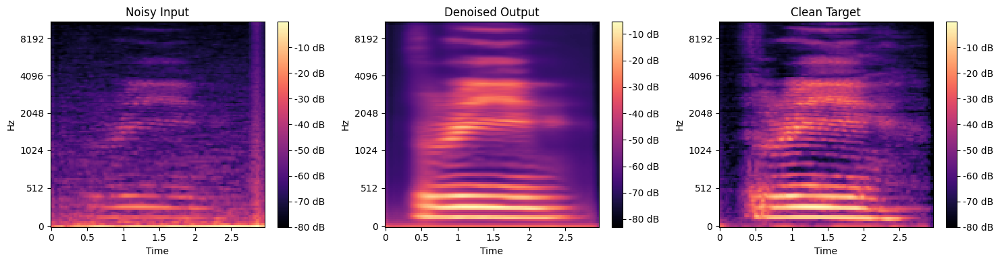
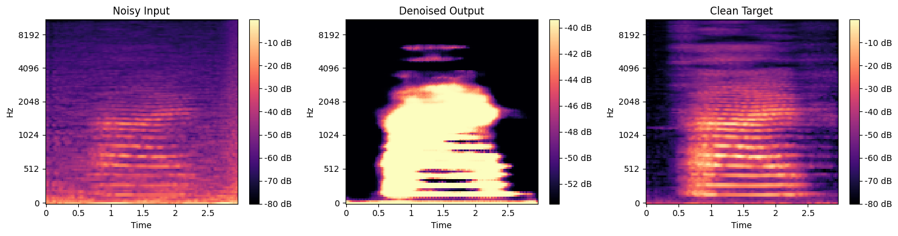
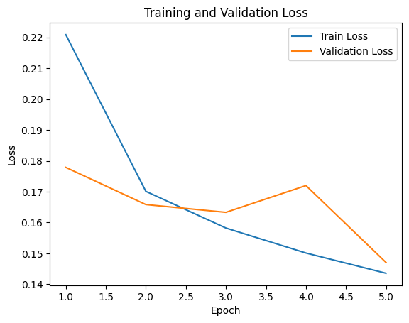
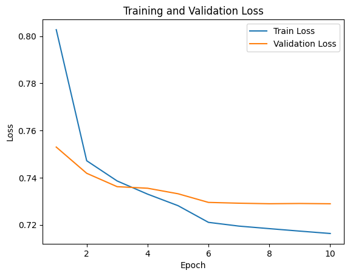
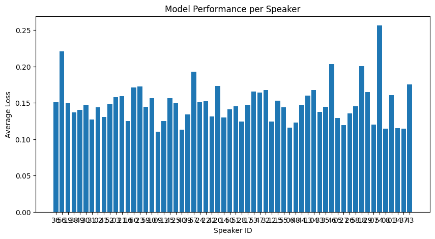
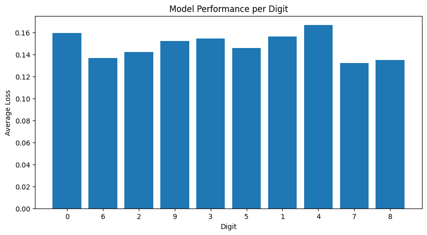
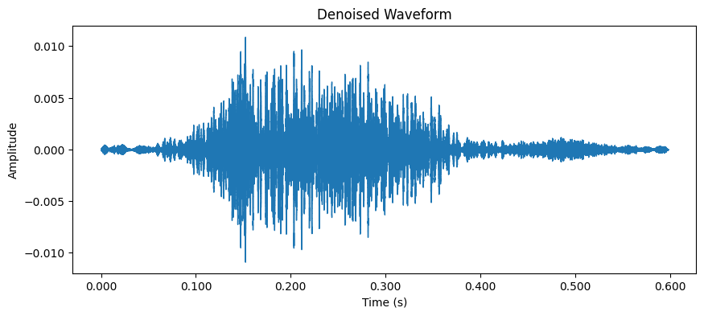

# Speech Denoising on Noisy AudioMNIST with a U-Net

Removing noise from short spoken-digit recordings with PyTorch. A network maps the log-mel spectrogram of
a noisy recording to that of the clean recording. A baseline convolutional autoencoder is compared with a
U-Net using a pretrained ResNet-34 encoder.

[](https://github.com/Kiana8181/speech-denoising-unet/actions/workflows/notebook.yml)

- **Executed notebook (HTML):** <https://kiana8181.github.io/speech-denoising-unet/>
- **Results report (PDF):** [`outputs/speech_denoising_unet_results.pdf`](outputs/speech_denoising_unet_results.pdf)
- **Notebook:** [`notebooks/speech_denoising_unet.ipynb`](notebooks/speech_denoising_unet.ipynb)

---

## Table of contents

1. [Project overview](#project-overview)
2. [Approach](#approach)
3. [Model architectures](#model-architectures)
4. [Dataset](#dataset)
5. [Repository structure](#repository-structure)
6. [Installation](#installation)
7. [Downloading the dataset](#downloading-the-dataset)
8. [Running the project](#running-the-project)
9. [Results](#results)
10. [Reproducing and interpreting the results](#reproducing-and-interpreting-the-results)
11. [Continuous integration and GitHub Pages](#continuous-integration-and-github-pages)
12. [Limitations](#limitations)

---

## Project overview

### Problem definition

Background noise degrades both human listening and downstream speech systems. Given a noisy recording of a
spoken digit, the goal is to **recover the clean speech**. This project treats denoising as an
**image-to-image regression** problem on time-frequency representations: the input is the noisy log-mel
spectrogram and the target is the clean one.

### Objectives

- Explore the dataset: speakers, durations and sampling rate.
- Build a preprocessing pipeline that turns variable-length recordings into fixed-size normalised
  spectrograms.
- Compare a baseline convolutional autoencoder with a U-Net that has a pretrained encoder and skip
  connections.
- Evaluate with MSE and SNR, analyse errors per speaker and per digit, and reconstruct audible waveforms.

## Approach

1. **Exploratory analysis** of the speaker metadata, durations and sampling rates. All recordings are
   48 kHz.
2. **Pairing:** each clean recording `<digit>_<speaker>_<index>.wav` is matched with its
   `<digit>_<speaker>_<index>_noisy.wav`, giving 30,000 pairs.
3. **Split:** random 80 / 10 / 10 % into 24,000 / 3,000 / 3,000 pairs (`random_state=42`).
4. **Feature extraction** (done on the fly in `AudioDataset`):
   - resample to 22,050 Hz with librosa;
   - time-stretch each waveform to a fixed length of 128 × 512 = 65,536 samples;
   - compute a mel spectrogram (128 mels, `n_fft=2048`, `hop_length=512`) and convert it to dB with
     `ref=np.max`;
   - z-normalise with the global mean and standard deviation of the training set
     (−53.52 dB and 14.14 dB);
   - resize to 128 × 128.
5. **Training** with an MSE loss, Adam (lr = 0.001), a `StepLR` scheduler and batch size 32.
6. **Evaluation** on the test pairs: MSE, SNR before and after denoising, spectrogram comparisons,
   per-speaker and per-digit error, and waveform reconstruction with Griffin-Lim.

## Model architectures

| | Convolutional autoencoder | U-Net |
|---|---|---|
| **Encoder** | 3 × [Conv3×3 stride 2 → BatchNorm → ReLU], 32-64-128 channels | ResNet-34, ImageNet-pretrained, adapted to 1 input channel |
| **Bottleneck** | Adaptive pooling to 16×16, then a fully connected 256-dimensional latent vector | Deepest ResNet-34 feature map |
| **Decoder** | Fully connected layer, then 3 × [ConvTranspose3×3 stride 2 → BatchNorm → ReLU] | `segmentation_models_pytorch` U-Net decoder |
| **Skip connections** | None | Yes, from each encoder stage |
| **Output** | `Sigmoid`, limited to `[0, 1]` | Linear, unrestricted |
| **Epochs** | 10 | 5 |

**Implementation details**

- `compute_global_mean_std` runs over the training set before training. Validation and test data are
  normalised with the same values.
- `AudioDataset` also returns the stretch factors, so reconstructed audio can be stretched back to its
  original duration.
- Paths and run settings come from environment variables (`AUDIO_DATA_DIR`, `QUICK_RUN`, `NUM_WORKERS`), so
  the notebook runs unchanged locally, in Docker or in CI.

## Dataset

**Noisy Audio MNIST**: 30,000 pairs of clean and noisy spoken digits (0–9), from 60 speakers with 50
repetitions per digit. It is a noisy version of the AudioMNIST dataset. About 2.4 GB zipped and 3.7 GB
unpacked, in 48 kHz WAV files.

| Item | Content |
|---|---|
| `audioMNIST_meta.txt` | JSON metadata per speaker: age, gender, accent, origin, native speaker, recording details |
| `<speaker>/<digit>_<speaker>_<index>.wav` | clean recording |
| `<speaker>/<digit>_<speaker>_<index>_noisy.wav` | noisy version of the same recording |

- Dataset used by this project: <https://www.kaggle.com/datasets/mahdiahmadi81/noisy-audio-mnist>
- Original clean dataset, AudioMNIST: <https://github.com/soerenab/AudioMNIST>

The dataset is **not** stored in this repository because of its size. Check the dataset pages for the
license and usage terms.

## Repository structure

```text
speech-denoising-unet/
├── .github/workflows/notebook.yml     # CI: executed notebook → index.html (Pages) + artifact
├── data/README.md                     # where the dataset goes (data itself is git-ignored)
├── notebooks/
│   └── speech_denoising_unet.ipynb    # full pipeline, stored with the outputs of the full run
├── outputs/
│   ├── figures/*.png                  # plots extracted from the notebook
│   ├── metrics.json                   # per-model metrics parsed from the stored outputs
│   └── speech_denoising_unet_results.pdf
├── scripts/
│   ├── download_data.py               # full or sample download (no Kaggle account needed)
│   └── run_pipeline.py                # execute notebook, export HTML, figures and PDF
├── requirements.txt
└── README.md
```

## Installation

### Prerequisites

- Python **3.10–3.12** (tested with 3.11)
- `git`
- For the full training run, a CUDA GPU is strongly recommended. One U-Net epoch took about 37 minutes on a
  GPU, mostly because spectrograms are computed on the fly (a pass over the training set without any model
  took about as long). A CPU is enough for the quick smoke test.
- About 4 GB of disk space for the dataset.
- Internet access on the first run, to download the pretrained ResNet-34 weights.

### 1. Clone the repository

```bash
git clone https://github.com/Kiana8181/speech-denoising-unet.git
cd speech-denoising-unet
```

### 2. Create and activate a virtual environment

macOS / Linux:

```bash
python3.11 -m venv .venv
source .venv/bin/activate
```

Windows (PowerShell):

```powershell
py -3.11 -m venv .venv
.venv\Scripts\Activate.ps1
```

Windows (Command Prompt):

```bat
py -3.11 -m venv .venv
.venv\Scripts\activate.bat
```

### 3. Install the dependencies

With an NVIDIA GPU (Linux or Windows), install the default PyTorch build:

```bash
python -m pip install --upgrade pip
pip install -r requirements.txt
```

CPU only (smaller download):

```bash
python -m pip install --upgrade pip
pip install -r requirements.txt --extra-index-url https://download.pytorch.org/whl/cpu
```

## Downloading the dataset

The download script needs no Kaggle account or API token. It uses Kaggle's public download link and only
the Python standard library.

**Full dataset (about 2.4 GB download), needed to reproduce the results:**

```bash
python scripts/download_data.py
```

**Small sample for a quick test (300 pairs from 6 speakers, about 40 MB, takes about 10 minutes):**

```bash
python scripts/download_data.py --sample 300
```

**Manual alternative:** download the zip from the
[Kaggle page](https://www.kaggle.com/datasets/mahdiahmadi81/noisy-audio-mnist) (or with
`curl -L -o noisy-audio-mnist.zip https://www.kaggle.com/api/v1/datasets/download/mahdiahmadi81/noisy-audio-mnist`)
and extract it. Either way, the result must look like this:

```text
data/noisy-audio-mnist/
├── audioMNIST_meta.txt
├── 01/
│   ├── 0_01_0.wav
│   ├── 0_01_0_noisy.wav
│   └── ...
└── ... (60 speaker folders)
```

No further preparation is needed. Pairing, splitting and feature extraction all happen inside the notebook.

## Running the project

### Full run (reproduces the reported results, GPU recommended)

```bash
python scripts/run_pipeline.py --inplace --timeout 36000
```

This executes the notebook from a fresh kernel and writes the outputs back into it (`--inplace`). It also
writes `site/index.html`, `outputs/figures/` and the PDF report. The whole run takes many hours because
spectrograms are computed on the fly, so `--timeout` allows a long per-cell time.

### Quick smoke test (CPU, about 3 minutes on the 300-pair sample)

`QUICK_RUN=1` trains each model for one epoch with batch size 8. It checks that the whole pipeline runs;
the resulting numbers are **not** meaningful. The command writes to separate folders so that the stored
results are not overwritten.

macOS / Linux:

```bash
QUICK_RUN=1 python scripts/run_pipeline.py --site-dir smoke/site --outputs-dir smoke/outputs
```

Windows (PowerShell):

```powershell
$env:QUICK_RUN="1"
python scripts/run_pipeline.py --site-dir smoke/site --outputs-dir smoke/outputs
```

### Export only (no training)

Rebuild `site/index.html`, the figures and the PDF from the outputs stored in the notebook. This is what
CI does.

```bash
python scripts/run_pipeline.py --no-execute
```

### Interactive

```bash
pip install jupyterlab
jupyter lab notebooks/speech_denoising_unet.ipynb
```

Run it from the `notebooks/` folder (Jupyter's default) so that the default data path
`../data/noisy-audio-mnist` resolves. To use a different location, set `AUDIO_DATA_DIR` before starting
Jupyter. The notebook writes reconstructed audio (`reconstructed_*.wav`) next to itself, and these files are
git-ignored.

## Results

The notebook is stored with the outputs of the **complete run on the full dataset on a GPU**. All numbers
below come from those outputs and are also in [`outputs/metrics.json`](outputs/metrics.json).

### Test set (3,000 pairs)

SNR is measured on z-normalised log-mel spectrograms. See [how to read the metrics](#reproducing-and-interpreting-the-results).

| Model | Epochs | Test MSE | Noisy SNR | Denoised SNR | Improvement |
|---|---:|---:|---:|---:|---:|
| Convolutional autoencoder | 10 | 0.7347 | 1.80 dB | 2.50 dB | +0.70 dB |
| **U-Net (ResNet-34 encoder)** | 5 | **0.1485** | 1.80 dB | **9.49 dB** | **+7.70 dB** |

### U-Net test MSE per spoken digit

| Digit | 7 | 8 | 6 | 2 | 5 | 9 | 3 | 1 | 0 | 4 |
|---|---:|---:|---:|---:|---:|---:|---:|---:|---:|---:|
| MSE | 0.1321 | 0.1351 | 0.1367 | 0.1421 | 0.1459 | 0.1524 | 0.1545 | 0.1562 | 0.1593 | 0.1667 |

Per speaker, the MSE ranges from 0.1102 (speaker 09) to 0.2565 (speaker 54). The values for all 60 speakers
are in `metrics.json`.

### Visualizations

**U-Net on a test recording**: noisy input, denoised output and clean target



**Autoencoder on a test recording**: note the narrow colour scale of the output



| U-Net loss | Autoencoder loss |
|---|---|
|  |  |

| U-Net MSE per speaker | U-Net MSE per digit |
|---|---|
|  |  |

**Waveform reconstructed with Griffin-Lim from the U-Net output**



All 14 figures are in [`outputs/figures/`](outputs/figures) and in the PDF report.

## Reproducing and interpreting the results

1. Install the dependencies (GPU build) and download the **full** dataset.
2. Run `python scripts/run_pipeline.py --inplace --timeout 36000`.
3. Compare the printed test metrics with the tables above. The data split is seeded, but weight
   initialisation and shuffling are not, so a rerun will not reproduce the numbers exactly. The size of this
   variation has not been measured. The stored run used a development snapshot of
   `segmentation_models_pytorch` (0.3.5.dev0), while `requirements.txt` pins the 0.4.0 release.

**How to read the metrics**

- **MSE** is computed on z-normalised log-mel spectrograms. A value of 1 is about the variance of the data
  itself, so lower is better and 0 is a perfect reconstruction.
- **SNR** here compares normalised spectrograms, `10·log10(mean(clean²) / mean((clean − x)²))`. It is **not**
  a conventional waveform SNR, so it should only be used to compare the models in this project, and not with
  published speech-enhancement results.
- **The U-Net is clearly better:** about five times lower MSE and +7.70 dB against +0.70 dB, in half as many
  epochs. The spectrograms show why: it keeps harmonics and timing, while the autoencoder produces a coarse
  blob.
- **Why the autoencoder struggles:** its `Sigmoid` output covers only `[0, 1]`, which is about −54 to −39 dB
  after de-normalisation (visible in the colour bar above), while the targets span about −80 to 0 dB. It also
  has no skip connections and only a 256-dimensional bottleneck.
- **Speakers and digits differ:** the error varies by more than a factor of two between speakers, and digit
  "4" is the hardest in this run.

## Continuous integration and GitHub Pages

The full run needs the 3.7 GB dataset, a GPU and many hours, so CI does **not** retrain. The workflow
[`.github/workflows/notebook.yml`](.github/workflows/notebook.yml) runs on every push to `main`, on pull
requests and on manual dispatch, and:

1. installs only the export tools (`matplotlib`, `nbconvert`, `nbformat`);
2. runs `python scripts/run_pipeline.py --no-execute`, which turns the stored executed notebook into
   `site/index.html` with all outputs and plots, extracts the figures and builds the PDF report;
3. uploads `site/index.html` and `outputs/` as the downloadable workflow artifact **`notebook-results`**;
4. on `main`, deploys `index.html` to **GitHub Pages**.

No dataset, Kaggle account or secret is needed in CI.

**One-time setup:** open **Settings → Pages** in the repository and set **Source** to
**GitHub Actions**. The site is then served at <https://kiana8181.github.io/speech-denoising-unet/>.

## Limitations

- **SNR is not waveform SNR.** See [how to read the metrics](#reproducing-and-interpreting-the-results).
- **Speakers are shared across splits.** Recordings are split at random, so the results do not measure
  performance on unseen speakers. A split by speaker would give a stricter estimate.
- **Griffin-Lim reconstruction** estimates the phase, so reconstructed audio contains artefacts, even for the
  clean spectrograms.
- **Fixed-size input:** every recording is time-stretched to one length and its spectrogram is resized to
  128 × 128, which changes its timing.
- **EDA plots assume 16 kHz:** the waveform and spectrogram plots in the exploration section assume 16 kHz
  while the files are 48 kHz, so their axes are not to scale. The training pipeline is not affected. This is
  also noted in the notebook.
- **Short training:** 10 and 5 epochs, with no early stopping or hyperparameter search. The U-Net's
  validation loss was still falling at its last epoch.
- **No fixed seeds** for weight initialisation and shuffling.

## Author

Kiana Hashemi
